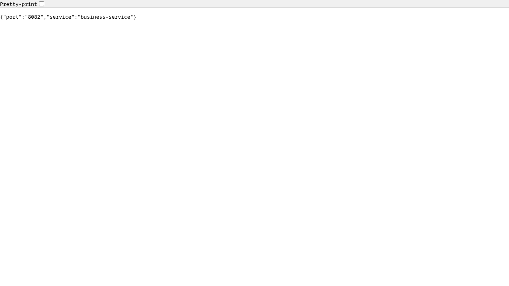

# Part 1: Hard-Coded Service Communication

## Objective and implementation

Demonstrate REST communication between two separate microservices using a fixed
destination address, then show what happens when the destination moves.

The order service listens on port **8081**. Its
`GET /api/hardcoded/business` endpoint sends a real HTTP GET to the business
service at **http://localhost:8082/api/businesses/instance**. Business returns
its application name and actual listening port. Order forwards that JSON to
the caller.

```text
Client → order-service:8081 → HTTP → business-service:8082
         /api/hardcoded/business    /api/businesses/instance
```

The destination is deliberately embedded in Java source:

```java
private final WebClient businessClient = WebClient.builder()
        .baseUrl("http://localhost:8082")
        .build();
```

See [HardCodedBusinessController.java](../microservices/order-service/order-service-main/src/main/java/kh/edu/istad/platform/order/discovery/HardCodedBusinessController.java)
and [InstanceController.java](../microservices/business-service/business-service-main/src/main/java/kh/edu/istad/platform/business/discovery/InstanceController.java).
This client is created directly with `WebClient.builder()` and does not use the
load-balanced builder. Eureka is unnecessary for this endpoint. The separate
`/api/discovery/business` endpoint is reserved for the discovery comparison.

The call uses a three-second response deadline. A connection failure, timeout,
or downstream error becomes HTTP **503 Service Unavailable**. This bounds the
wait and provides an explicit error; it cannot discover a replacement address.
This exercise is a diagnostic REST call, rather than validation of business
records when creating orders.

## Reproduce the experiment

Use JDK 25, PostgreSQL for order, and MongoDB for business. From the repository
root, start the databases using [the deployment guide](../deployment/README.md),
then build:

```bash
./gradlew -p microservices/business-service test :business-service-main:bootJar
./gradlew -p microservices/order-service test :order-service-main:bootJar
```

In separate terminals start business and order, with discovery disabled to
isolate the hard-coded communication:

```bash
java -jar microservices/business-service/business-service-main/build/libs/business-service-main-1.0.0.jar --eureka.client.enabled=false
java -jar microservices/order-service/order-service-main/build/libs/order-service-main-1.0.0.jar --spring.profiles.active=hardcoded-demo --eureka.client.enabled=false
```

Order defaults to PostgreSQL at `localhost:5433`. During the captured experiment,
the existing container did not publish that port. An isolated temporary
PostgreSQL container was used on host port **15433**, and order was launched
with `--spring.datasource.url=jdbc:postgresql://localhost:15433/istad_order`.
The database credentials and database name matched the deployment defaults.
Business used the existing MongoDB on port 2026.

Call business directly, then through order:

```bash
curl -i http://localhost:8082/api/businesses/instance
curl -i http://localhost:8081/api/hardcoded/business
```

Both should return HTTP 200 and JSON containing
`"service":"business-service"` and `"port":"8082"`.

Stop business with Ctrl+C, then restart it on a different port:

```bash
java -jar microservices/business-service/business-service-main/build/libs/business-service-main-1.0.0.jar --server.port=8182 --eureka.client.enabled=false
curl -i http://localhost:8182/api/businesses/instance
curl -i http://localhost:8081/api/hardcoded/business
```

The `hardcoded-demo` profile enables the historical Part 1 endpoint; normal
application runs expose the Eureka-based endpoint instead.

The direct call returns HTTP 200 with port 8182. Order still calls port 8082
and returns HTTP 503. Restarting order without changing its source cannot fix
the destination. Restore business to 8082 to restore the original communication.

## Recorded results and screenshots

These screenshots capture actual browser responses from the running Java
services on **23 October 2026**. The accompanying JSON files record each URL,
HTTP status, response body, capture time, and screenshot filename. Browser
content screenshots do not include the browser address bar; use the matching
JSON evidence for the request URL and HTTP status.

| Test | Request | Observed result |
| --- | --- | --- |
| Direct business call | `GET localhost:8082/api/businesses/instance` | 200; business port 8082 |
| Order → business | `GET localhost:8081/api/hardcoded/business` | 200; forwarded business port 8082 |
| Business after port change | `GET localhost:8182/api/businesses/instance` | 200; business port 8182 |
| Unchanged order → old address | `GET localhost:8081/api/hardcoded/business` | 503 Service Unavailable |

**1. Business running at the original address**


**2. Successful REST communication through order**



**3. Business remains available after moving to port 8182**


**4. The caller fails because it still targets port 8082**


Machine-readable evidence: [successful calls](screenshots/part1/success.json)
and [calls after moving business](screenshots/part1/moved.json).

The [capture script](../scripts/capture-part1.mjs) asserts the statuses and
returned ports before saving screenshots. With Playwright installed and its
Chromium browser available, run it from the root at the corresponding stages:

```bash
node scripts/capture-part1.mjs success
# Stop business on 8082 and restart it on 8182 first.
node scripts/capture-part1.mjs moved
```

Set `PLAYWRIGHT_MODULE` to an installed Playwright module path and
`CHROMIUM_PATH` to a Chromium executable if they are outside the normal Node
module path and Playwright browser cache.

## Problems, limitations, and disadvantages

1. **Location coupling.** The caller knows the destination host and port.
   The experiment demonstrated the consequence: a healthy service on 8182 is
   unreachable through a caller compiled for 8082.
2. **Source changes and redeployment.** Moving business requires editing the
   fixed URL, rebuilding, and redeploying every caller that embeds it. Multiple
   callers increase maintenance work and the chance of inconsistent addresses.
3. **Environment differences.** A development address may be wrong in staging
   or production. `localhost` refers to the caller's own network namespace;
   inside separate containers it ordinarily does not identify another container.
4. **No automatic instance selection.** This client always targets one host
   and port. Adding another business instance does not distribute requests to
   it. A separately configured proxy could balance traffic, but none is used in
   this baseline.
5. **No automatic failover.** If the fixed target stops, the client cannot
   select a healthy replacement. It returns an error even if another instance
   is available elsewhere, as the port-change experiment showed.
6. **No registry-based health awareness.** The client learns about trouble only
   when an HTTP call fails or times out. It has no list of healthy instances
   from which to select a destination. A reachable port also does not guarantee
   that business operations or database dependencies are healthy.
7. **Scaling and deployment friction.** Autoscaling, host replacement, and
   rolling deployments can change instance locations. Manually synchronizing
   embedded URLs makes these changes harder to coordinate.
8. **Failure propagation.** Downstream failures cause upstream errors and can
   consume resources while requests wait. The three-second deadline limits
   waiting in this example, but the baseline includes no circuit breaker,
   retry policy, or fallback instance.

A fixed URL is straightforward for a small local demonstration. This experiment
shows its practical weakness: service availability and address stability are
different things. External configuration can remove the need to recompile an
address, while service discovery and client-side load balancing can additionally
select among registered instances. Discovery still requires timeouts and
failure handling because registry information can become stale.
