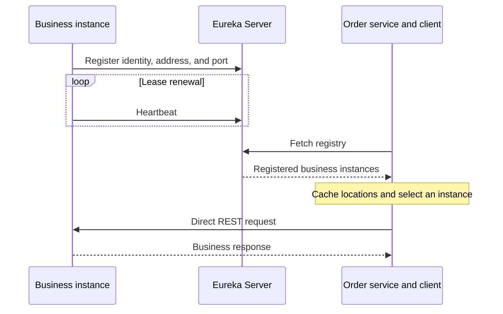

# Part 2: Research Spring Cloud Eureka

Research date: 23 October 2026. Sources are Netflix's own documentation and
Spring's official reference documentation.

## 1. Origin and purpose

**Eureka was developed by Netflix** for its cloud infrastructure. Netflix's
engineering retrospective places the open-sourcing of Eureka and related
infrastructure libraries around **2012**. Spring Cloud Netflix subsequently
made Eureka convenient to integrate into Spring applications.
[Netflix engineering retrospective](https://medium.com/netflix-techblog/netflix-oss-and-spring-boot-coming-full-circle-4855947713a0),
[Spring Cloud Netflix reference](https://docs.spring.io/spring-cloud-netflix/reference/spring-cloud-netflix.html).

Netflix describes Eureka as a REST-based registry supporting discovery and
resilient communication between middle-tier services. These are backend
services that call one another. Cloud instances can start, stop, and change
location, so callers need a way to find them dynamically.
[Netflix Eureka repository](https://github.com/Netflix/eureka).

Eureka associates a logical service name with its running instances. For
example, a caller can look up `business-service` rather than embedding one
instance's IP address and port. Although its origins are in AWS, applications
can use Eureka outside AWS, including a local Spring Boot deployment.
[Netflix architecture overview](https://github.com/Netflix/eureka/wiki/Eureka-at-a-glance),
[Spring standalone-server configuration](https://docs.spring.io/spring-cloud-netflix/reference/spring-cloud-netflix.html).

## 2. Core concepts

| Concept | Meaning | Example in this project |
| --- | --- | --- |
| **Eureka Server** | Hosts the registry and accepts registration, renewal, and lookup requests. Peer servers can replicate registrations. | `discovery-server` on port 8761 |
| **Eureka Client** | A component within an application that communicates with the registry. It can advertise its own instance and obtain information about other services. | Business registers itself; order looks up business instances. |
| **Service registration** | Publishing an instance's identity, address, port, status, and metadata to the registry. | Business advertises an instance under `business-service`. |
| **Service discovery** | Obtaining registered instance locations using a logical service identifier. | Order discovers the addresses associated with `business-service`. |

The client starter enables registration and discovery integration. The server
starter and `@EnableEurekaServer` provide the registry application.
[Spring Cloud Netflix reference](https://docs.spring.io/spring-cloud-netflix/reference/spring-cloud-netflix.html).

An application can consume services and provide services simultaneously.
Registration and registry retrieval are separately configurable through
`eureka.client.register-with-eureka` and `eureka.client.fetch-registry`.
[Spring Eureka configuration properties](https://docs.spring.io/spring-cloud-netflix/reference/configprops.html).

## 3. Registration and discovery lifecycle

1. **Start and register.** A business instance sends its identity and location
   to the configured Eureka Server.
2. **Renew its lease.** The instance periodically sends heartbeats so its
   registration remains active.
3. **Retrieve the registry.** Order's Eureka Client periodically fetches
   instance information and maintains a local cache.
4. **Choose an instance.** For a request to `business-service`, Spring Cloud
   LoadBalancer selects an instance from the discovered list.
5. **Send the business request.** Order calls the selected business instance
   directly over HTTP. Eureka does not relay this application request.
6. **Handle departure.** A graceful shutdown unregisters the instance. After
   an ungraceful failure, expiration and eviction can remove it, subject to
   self-preservation and propagation delays.

These stages combine Eureka's registration/cache lifecycle with Spring Cloud's
client-side instance selection.
[Netflix architecture overview](https://github.com/Netflix/eureka/wiki/Eureka-at-a-glance),
[Netflix self-preservation documentation](https://github.com/Netflix/eureka/wiki/Server-Self-Preservation-Mode),
[Spring Cloud LoadBalancer](https://docs.spring.io/spring-cloud-commons/reference/spring-cloud-commons/loadbalancer.html).

Spring documents default client registry fetching every **30 seconds** and
default lease renewal/expiration settings of **30/90 seconds**. These values
are configurable. Expiration is not a guarantee of removal or caller recovery
at exactly 90 seconds: eviction, caches, and self-preservation affect timing.
[Spring Eureka configuration properties](https://docs.spring.io/spring-cloud-netflix/reference/configprops.html),
[Netflix self-preservation documentation](https://github.com/Netflix/eureka/wiki/Server-Self-Preservation-Mode).

## 4. Key capabilities

| Capability | Practical benefit |
| --- | --- |
| Dynamic registration and lookup | Instances can change while callers continue to use a service name. |
| Multiple instances per service | The registry supplies candidates for client-side load balancing. |
| Local registry caching | Existing discovery information can remain usable during registry outages. |
| Instance metadata | Clients can obtain more than an address, including status and application metadata. |

These are core Eureka capabilities described by Netflix.
[Netflix architecture overview](https://github.com/Netflix/eureka/wiki/Eureka-at-a-glance).

Spring also supports peer Eureka servers and propagating Actuator application
health to the registry. Heartbeats alone do not establish database or business
operation health; health integration must be configured appropriately.
[Spring Eureka server and health documentation](https://docs.spring.io/spring-cloud-netflix/reference/spring-cloud-netflix.html).

In this project, **Eureka supplies discovery information and Spring Cloud
LoadBalancer selects the destination**. Its default algorithm is round-robin.
An `@LoadBalanced WebClient.Builder` allows the caller to use
`http://business-service`. Adding Eureka alone does not rewrite existing
hard-coded REST clients.
[Spring Cloud LoadBalancer](https://docs.spring.io/spring-cloud-commons/reference/spring-cloud-commons/loadbalancer.html).

## 5. Drawbacks and limitations

- **Stale information and delayed convergence.** Cached locations can briefly
  include a failed instance or omit a new one. Discovery cannot guarantee
  that a selected instance is still reachable when a request arrives.
  [Netflix architecture overview](https://github.com/Netflix/eureka/wiki/Eureka-at-a-glance).
- **Self-preservation tradeoff.** When renewals drop significantly, Eureka can
  suspend eviction to avoid deleting registrations during a network problem.
  This protects registry availability but can retain dead instances. Disabling
  the feature removes that protection.
  [Netflix self-preservation documentation](https://github.com/Netflix/eureka/wiki/Server-Self-Preservation-Mode).
- **Infrastructure overhead.** Operators must deploy, configure, monitor, and
  protect the registry. Peer replication improves availability but adds
  configuration and operational work.
  [Spring Eureka server documentation](https://docs.spring.io/spring-cloud-netflix/reference/spring-cloud-netflix.html).
- **Integration effort outside Java.** Non-Java applications can use Eureka's
  REST API, but need suitable client integration for registration, renewal,
  and lookup.
  [Netflix architecture overview](https://github.com/Netflix/eureka/wiki/Eureka-at-a-glance).

The following are architectural implications for this project:

- A single registry is a discovery availability risk. Cached callers may
  continue using known instances, while fresh clients and topology changes
  are affected by an outage.
- Registry bootstrap addresses and reachable advertised instance addresses
  still require configuration. Discovery does not solve network routing errors.
- Service lookup does not provide circuit breakers, safe retries, transaction
  coordination, or guaranteed successful requests. Callers still need timeouts
  and explicit error handling.
- Registry health is useful routing information, but cannot prove every
  application operation will succeed.

## 6. Connection to the Part 1 experiment

Part 1 demonstrated a working business instance on port 8182 while order still
called its fixed address on 8082 and returned HTTP 503. With discovery enabled,
the replacement instance can register under the same `business-service` name.
After registry propagation, order's load-balanced client can select its new
address without a caller source change. Recovery is asynchronous, so transient
errors remain possible.

See [Part 1 results and screenshots](part1-hardcoded-communication.md) and
[the Eureka implementation/run guide](eureka-discovery.md).
