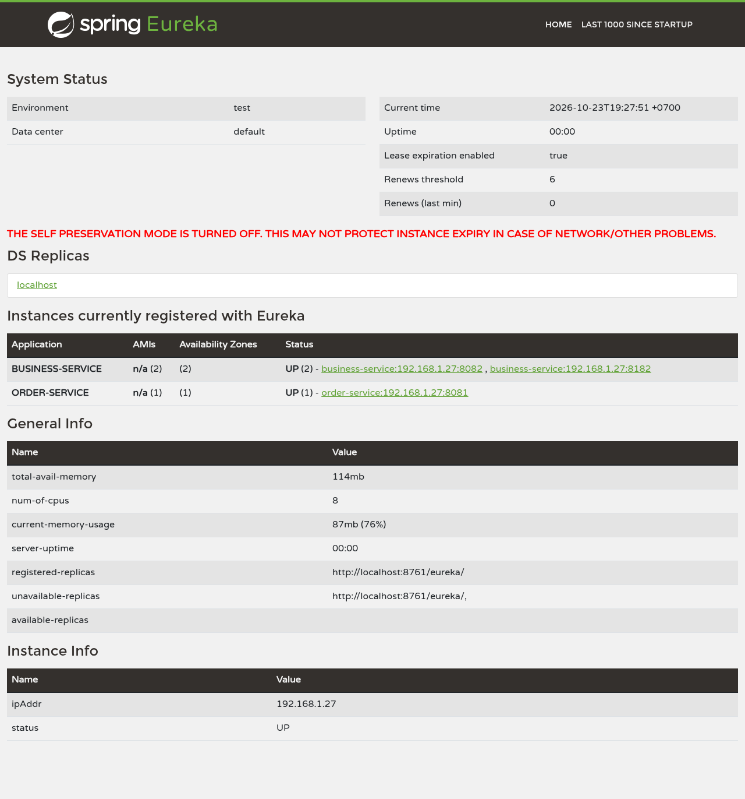
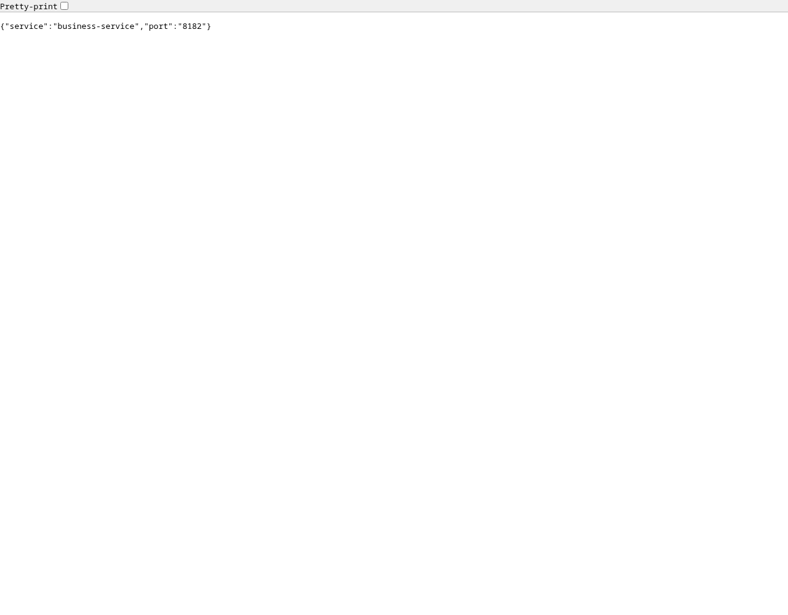
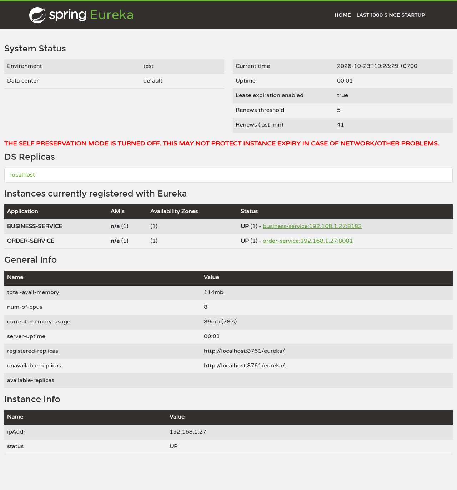

# Part 3: Integrate Eureka

## Implementation

The normal order-service communication path now resolves a service name through
Eureka and selects a business instance through Spring Cloud LoadBalancer:

```text
GET localhost:8081/api/discovery/business
       ↓
@LoadBalanced WebClient → http://business-service/api/businesses/instance
       ↓ selects a discovered UP instance
business-service:8082 OR business-service:8182
```

The caller embeds **no business instance host or port**. Eureka supplies the
locations, and LoadBalancer performs client-side selection. The business HTTP
request goes directly from order to the selected instance.

Relevant implementation:

- [Discovery server](../microservices/discovery-server/src/main/java/kh/edu/istad/platform/discovery/DiscoveryServerApplication.java)
  enables Eureka Server; its default port is 8761.
- [Client convention](../build-logic/src/main/groovy/discovery-client-conventions.gradle)
  adds Eureka Client, Actuator, and the Spring Cloud dependency BOM to all four
  service application modules.
- [WebClient configuration](../microservices/order-service/order-service-main/src/main/java/kh/edu/istad/platform/order/discovery/DiscoveryClientConfiguration.java)
  provides the `@LoadBalanced WebClient.Builder`.
- [Discovery controller](../microservices/order-service/order-service-main/src/main/java/kh/edu/istad/platform/order/discovery/BusinessDiscoveryController.java)
  calls `http://business-service`, imposes a three-second response deadline,
  and maps downstream failures to HTTP 503.
- [Business instance endpoint](../microservices/business-service/business-service-main/src/main/java/kh/edu/istad/platform/business/discovery/InstanceController.java)
  returns the service name and actual port so instance selection is observable.

The historical `/api/hardcoded/business` endpoint is enabled only by the
`hardcoded-demo` profile, preserving the Part 1 exercise. Without that profile
it returns 404; it is absent from normal application runs. The captured
Part 1 artifacts remain available for comparison. Existing order-creation
behavior is unaffected; this exercise demonstrates a diagnostic REST call.

Each service registers using its `spring.application.name`. Clients obtain
the registry bootstrap address from `EUREKA_SERVER_URL`, defaulting to
`http://localhost:8761/eureka/`. A stable bootstrap location remains necessary.
Actuator health propagation is enabled in each service's `application.yaml`.

## Repeat the live test

Prerequisites: JDK 25, Docker with the `postgres:17` image, MongoDB available on
host port 2026 using the deployment defaults, Node.js, and Playwright with
Chromium. Ports **8761, 8081, 8082, 8182, and 15433** must be free. Run from the
repository root:

```bash
./gradlew -p microservices/discovery-server test bootJar
./gradlew -p microservices/business-service test :business-service-main:bootJar
./gradlew -p microservices/order-service test :order-service-main:bootJar
node scripts/verify-part3.mjs
```

The [verification script](../scripts/verify-part3.mjs) starts a temporary
PostgreSQL container, Eureka, order, and two separate business JVMs. It waits
for health and registration, checks real HTTP responses, takes screenshots,
and stops its Java processes and temporary database in `finally`. It does not
stop the shared MongoDB container. Optional environment variables:

| Variable | Purpose |
| --- | --- |
| `JAVA_COMMAND` | Path to a JDK 25 `java` executable if the default is older |
| `PLAYWRIGHT_MODULE` | Path to Playwright's module if outside the normal Node module path |
| `CHROMIUM_PATH` | Chromium executable if outside Playwright's default browser cache |

The script uses `discovery-demo` on server and clients: five-second registry
fetch/renewal intervals, a fifteen-second lease expiration, five-second server
eviction/cache intervals, and no additional LoadBalancer cache. Server
self-preservation is disabled for observable local eviction. Normal profiles
retain self-preservation and normal cache/lease defaults. The script advertises
loopback IPs because all test JVMs run on the same host.

For manual startup and curl commands, see
[the Eureka run guide](eureka-discovery.md).

## Tests and screenshots

The recorded run completed on **23 October 2026, 19:28:34 Asia/Phnom_Penh**.
All twelve initial requests returned HTTP 200: **six reached 8082 and six
reached 8182**. After SIGKILL on 8082, the test's convergence condition was met
in **37.347 seconds**: the registry contained only 8182 and at least six
consecutive probes had successfully reached it. During that observation window,
the probes recorded **21 HTTP 200 responses and 17 HTTP 503 responses**. This
includes the confirmation probes; it is not a measurement of the exact first
instant recovery became possible. With both instances stopped, HTTP 503 was
verified again. The Gradle order-service tests and executable jar build passed.

The live integration test uses the **actual Eureka registry**, independent
business JVMs, and the actual order REST endpoint. It verifies:

| Scenario | Required result |
| --- | --- |
| Both business instances register | Eureka shows business 8082 and 8182 UP |
| Twelve consecutive calls through order | HTTP 200; responses identify both instance ports |
| Historical Part 1 endpoint without its profile | HTTP 404 |
| Business 8082 terminated with SIGKILL | After expiry/refresh, registry and requests converge on 8182 |
| Both business instances stopped | Order returns HTTP 503 |

The automated [BusinessDiscoveryTest](../microservices/order-service/order-service-main/src/test/java/kh/edu/istad/platform/order/discovery/BusinessDiscoveryTest.java)
also checks the production load-balanced controller with two real local HTTP
servers and verifies failure handling. That smaller test uses Spring's simple
discovery client to run independently of Eureka and databases; the live test
above verifies the Eureka integration itself.

**Registry with two business instances**



**Same caller endpoint reaches business on 8082**


**Same caller endpoint reaches business on 8182**


**Caller reaches the survivor after 8082 fails**



**Registry after the failed instance is evicted**



**No business instances available**


Screenshots show actual browser responses and the Eureka dashboard. API browser
content screenshots do not show an address bar; matching URLs, HTTP statuses,
response bodies, registry snapshots, failure-convergence samples, and timestamps
are recorded in [results.json](screenshots/part3/results.json). Local JVM logs
are generated alongside the evidence and excluded from Git.

## Comparison with hard-coded communication

| Aspect | Part 1: hard-coded URL | Part 3: Eureka discovery |
| --- | --- | --- |
| Destination | `http://localhost:8082` | Logical ID `http://business-service` |
| Instance location changes | Caller source needs updating for a new destination | Registration updates the available locations without caller source edits |
| Multiple instances | Caller always targets 8082 | Tested calls reach both 8082 and 8182 |
| Original instance fails | Calls continue targeting the failed address | After convergence, calls reach surviving 8182 |
| Health information | Failure is detected during the call | Registry status includes configured Actuator health propagation |
| Operational complexity | Simple setup, manual address maintenance | Registry deployment, configuration, and monitoring required |
| Failure handling | Three-second deadline and HTTP 503 | Same deadline/error handling remains necessary |

The Part 1 experiment returned HTTP 503 even though business was healthy on
8182. The Eureka experiment successfully reaches 8182 through the unchanged
order endpoint after 8082 fails. Both approaches use real REST calls; the
improvements come from discovering and selecting the destination dynamically.

## Remaining limitations

- **Recovery is asynchronous.** Lease expiration, eviction scheduling, and
  registry refresh can leave a failed instance selectable temporarily. The
  script records transient outcomes rather than claiming instant failover.
- **Demo timing differs from production.** The shortened profile and disabled
  self-preservation make failure removal observable locally. Its measured
  convergence time is not a production recovery guarantee.
- **The registry is infrastructure to operate.** This exercise uses one server.
  Production resilience requires appropriate peer deployment and protection.
  Cached clients may continue during a registry outage but cannot learn updates.
- **Health reporting is not a request guarantee.** An instance can fail after
  lookup, and an UP status does not prove every business operation will succeed.
- **No surviving instance means no successful call.** HTTP 503 is expected
  after both business instances stop.
- **Discovery does not add retries or circuit breakers.** This implementation
  has neither. Safe retries, especially for writes, need separate design.
- **Addresses must remain reachable.** Registry and database bootstrap
  configuration, container networking, and correctly advertised IPs still matter.
- **This is a local functional experiment.** It does not measure throughput,
  exercise a multi-node registry outage, or prove distributed transaction behavior.

For the underlying behavior and official references, see
[the Part 2 research report](part2-eureka-research.md).
