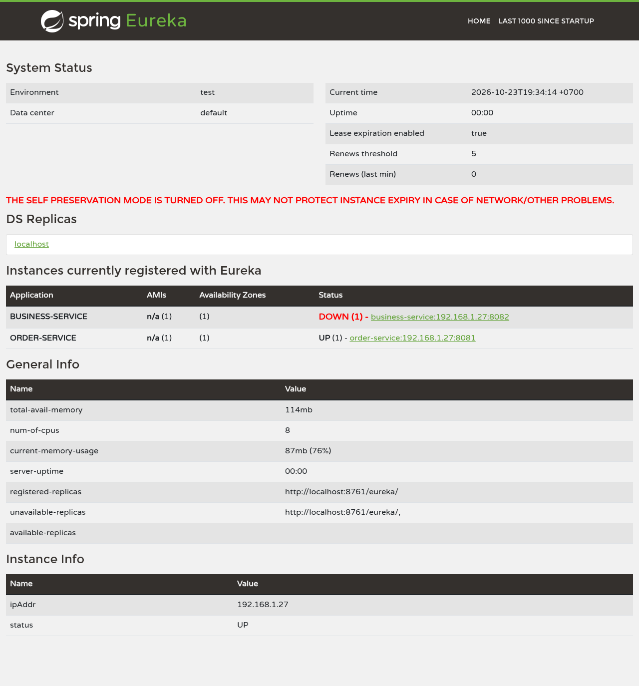
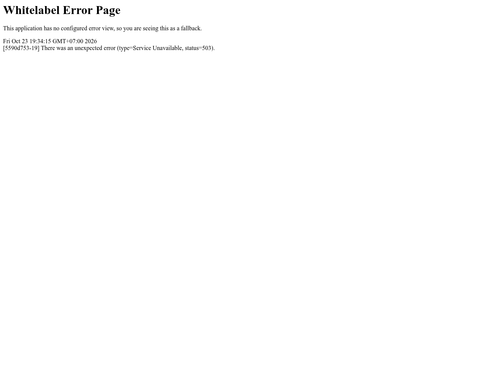
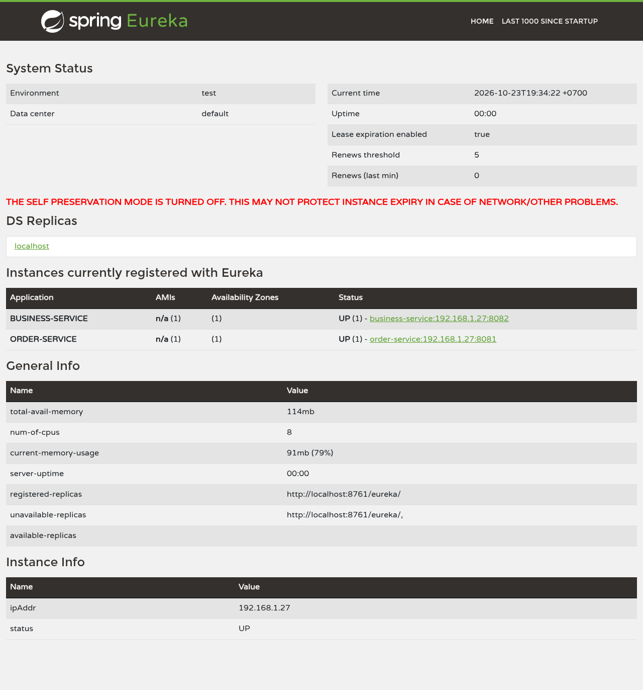
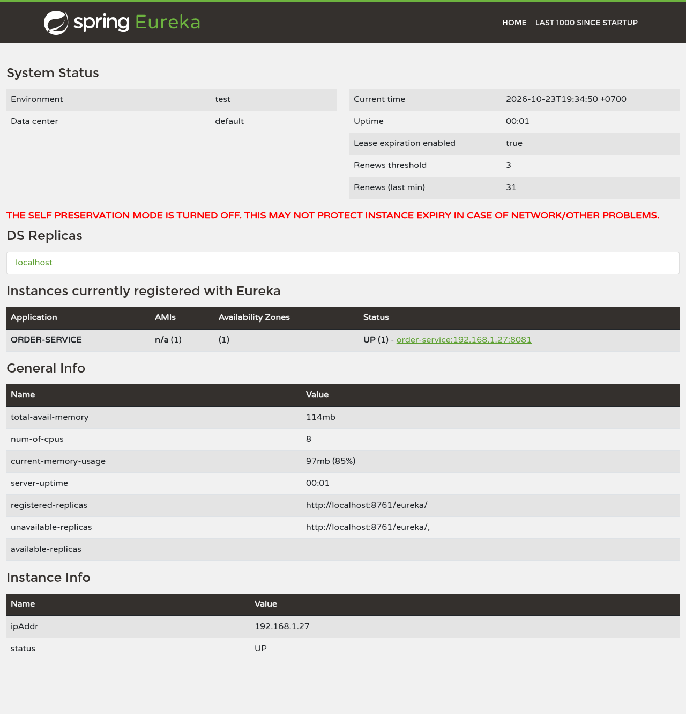
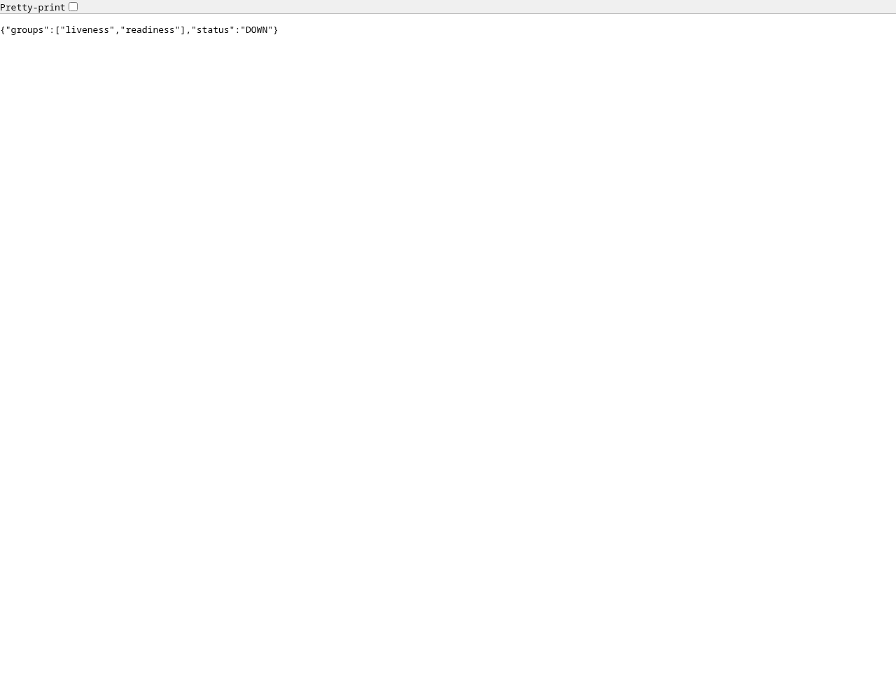
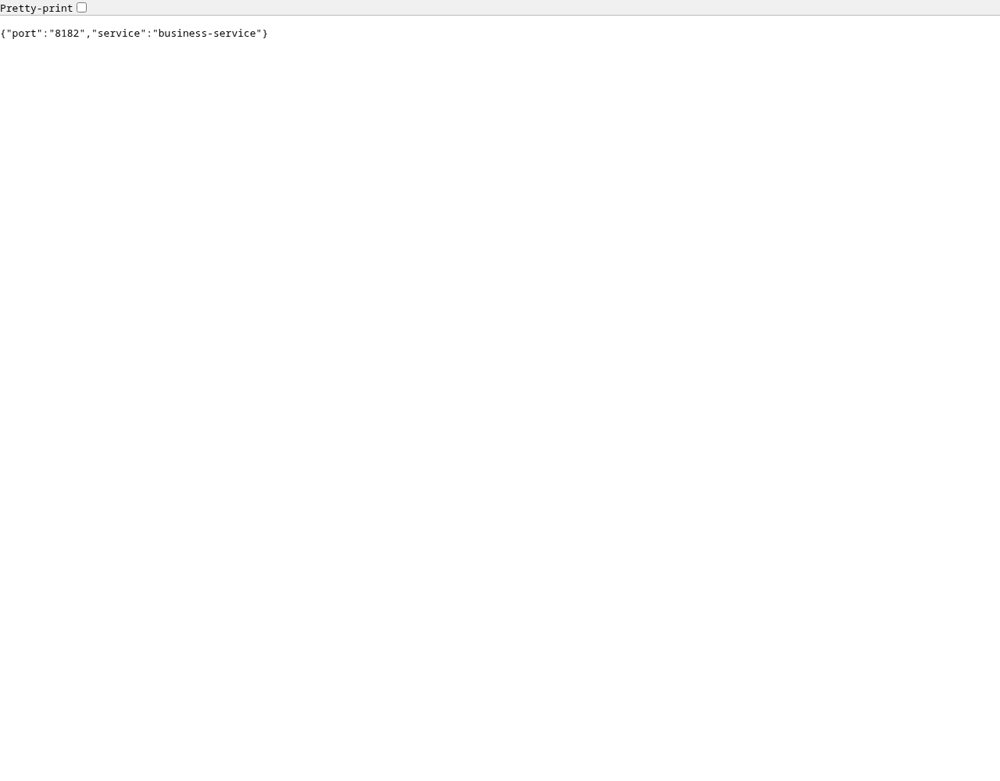
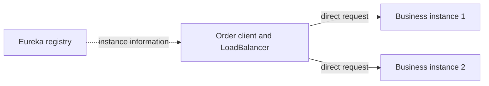
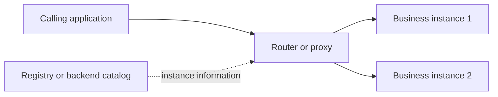

# Part 4: Experiment with Eureka

## Scope and setup

This experiment runs the actual Eureka Server, order-service caller, and
business-service provider. An isolated PostgreSQL container serves order;
an isolated MongoDB container on host port **12026** serves business. The shared
development databases are not stopped or paused.

The [verification script](../scripts/verify-part4.mjs) starts the applications,
checks HTTP responses and registry states, pauses/restores its own MongoDB,
tests graceful and abrupt process termination, and captures screenshots.
Each recorded observation includes a timestamp, elapsed time, registry metadata,
Actuator response, and caller response in
[results.json](screenshots/part4/results.json).

The MongoDB URI uses one-second selection, connection, socket, and heartbeat
settings to keep dependency-failure detection bounded in this local experiment.
These are MongoDB driver settings, separate from Eureka's lease timers.

## Health tracking and configuration

Three signals answer different questions:

- **HTTP reachability:** can a process answer a request?
- **Actuator health:** do the configured health contributors report healthy
  dependencies and application state?
- **Eureka lease/status:** is the registration renewed, and what status has
  been published to the registry?

Spring's Eureka integration can publish Actuator health through
`eureka.client.healthcheck.enabled`. A renewed heartbeat alone does not prove
that a database-dependent operation can succeed. The server does not normally
poll every client's `/actuator/health` URL to determine its application health;
the client-side integration reports that status.
[Spring Eureka health documentation](https://docs.spring.io/spring-cloud-netflix/reference/spring-cloud-netflix.html).

The experiment explicitly compares health propagation **true** and **false**
by restarting business with a command-line property override. The normal
application configuration keeps it enabled. Additional settings come from the
existing `discovery-demo` profile:

| Property | Experiment value | Purpose |
| --- | --- | --- |
| `eureka.client.healthcheck.enabled` | `true`, then `false` | Compare dependency-aware status with lease-only behavior |
| `eureka.instance.lease-renewal-interval-in-seconds` | `5` | Heartbeat cadence |
| `eureka.instance.lease-expiration-duration-in-seconds` | `15` | Lease expiration threshold |
| `eureka.client.registry-fetch-interval-seconds` | `5` | Caller registry refresh |
| `eureka.client.initial-instance-info-replication-interval-seconds` | `5` | Initial replication scheduling |
| `eureka.client.instance-info-replication-interval-seconds` | `5` | Client status replication scheduling |
| `eureka.server.eviction-interval-timer-in-ms` | `5000` | Server eviction scheduling |
| `eureka.server.response-cache-update-interval-ms` | `5000` | Registry response cache refresh |
| `eureka.server.enable-self-preservation` | `false` in demo | Permit observable local failure eviction |
| `spring.cloud.loadbalancer.cache.enabled` | `false` in demo | Avoid another instance-list cache |

Spring documents default renewal/expiration values of **30/90 seconds**, client
registry fetching every **30 seconds**, and server response cache refresh every
**30 seconds**. Shorter intervals increase refresh/renewal traffic and make
temporary delays more likely to trigger removal. Expiration should exceed the
renewal interval. These are configurable timings, not exact end-to-end recovery
guarantees.
[Spring Eureka configuration properties](https://docs.spring.io/spring-cloud-netflix/reference/configprops.html).

Self-preservation is normally enabled. When renewals drop substantially, it can
suspend eviction to protect registry contents during network disruption.
Consequently, genuinely failed instances may remain listed. The demo disables
it to make eviction visible; this run does not compare enabled/disabled
self-preservation behavior experimentally.
[Netflix self-preservation documentation](https://github.com/Netflix/eureka/wiki/Server-Self-Preservation-Mode).

## Experiments and observations

The recorded run completed on **23 October 2026 at 19:36:02 Asia/Phnom_Penh**.
The observed conditions were reached after approximately **9.3 seconds** for
initial business startup, **10.1 seconds** for dependency failure to reach
DOWN/503, **7.1 seconds** for dependency recovery, **28.1 seconds** for the
graceful-stop observation, **32.3 seconds** for abrupt-failure eviction, and
**11.2 seconds** for restart on the new port. The disabled-propagation case
remained registry-UP while Actuator was DOWN across a sixteen-second sampling
window, with its final observation at **18.1 seconds** after pausing MongoDB.
These elapsed values include waiting for each experiment's combined conditions.
Graceful deregistration was confirmed in the local client log with a successful
HTTP 200 cancellation; its full observed convergence still took time.

The script checks each condition before capturing its screenshots:

| Scenario | Registry observation | Caller observation | Meaning |
| --- | --- | --- | --- |
| Before business starts | No business registration | HTTP 503 | No available target exists |
| Business starts | Business becomes UP | HTTP 200 | Registration and caller refresh make the new instance usable |
| MongoDB paused; health propagation enabled | Business becomes DOWN but remains registered | HTTP 503 after refresh | Dependency failure excludes the instance from discovered UP targets |
| MongoDB restored | Business returns to UP | HTTP 200 | Health status and routing recover without a business restart |
| Graceful SIGTERM | Business unregisters | HTTP 503 after refresh | Clean shutdown can cancel registration without waiting for lease expiry |
| MongoDB paused; health propagation disabled | Business remains UP over multiple renewal cycles | Diagnostic call returns HTTP 200 while Actuator returns 503/DOWN | Heartbeats alone miss dependency failure |
| Abrupt SIGKILL | Stale registration initially; later evicted | HTTP 503 | Missing renewals need expiration, eviction, and cache convergence |
| Business restarts on 8182 | New instance becomes UP | HTTP 200 identifying port 8182 | Caller discovers the replacement address |

The `/api/businesses/instance` diagnostic does not query MongoDB. During the
enabled-health dependency failure it can still respond directly with HTTP 200,
even while Actuator reports DOWN and discovered callers exclude the instance.
Likewise, HTTP 200 with propagation disabled is not evidence that database-backed
business operations are healthy. This distinction is central to the experiment.

**Startup and registration**


**Database unavailable: Actuator reports DOWN**


**Database unavailable: registry reports DOWN**



**Caller after DOWN status propagates**



**Dependency restored without restarting business**



**Graceful shutdown removes the registration**



**Health propagation disabled: registry still shows UP**


**Same instance's Actuator health is DOWN**



**Abrupt stop initially leaves a stale registration**


**Failed instance eventually evicted**


**Restart on a new port**


**Caller reaches the replacement instance**



Screenshots show real browser responses and the registry dashboard. Browser
content screenshots omit the address bar; the JSON evidence records URLs and
statuses. Java logs are saved locally alongside the evidence and ignored by Git.
Observed timing is specific to these demo settings, local scheduling, and the
script's polling conditions; it is not a production service-level guarantee.

## Client-side versus server-side discovery and load balancing

**Discovery** finds eligible instance locations. **Load balancing** selects a
destination among them. The terms describe related responsibilities; a registry
can provide discovery information without forwarding application requests.

In **client-side discovery**, the calling application obtains instance locations
from a registry, commonly through a library and cache. Client-side load balancing
then selects a destination before the application calls it directly. This is the
pattern used by order-service in this project.
[Client-side discovery pattern](https://microservices.io/patterns/client-side-discovery.html).



Spring Cloud LoadBalancer supplies the selection mechanism; its default
implementation is round-robin. Eureka Server is the registry and does not
serve as the reverse proxy for order-to-business requests.
[Spring Cloud LoadBalancer](https://docs.spring.io/spring-cloud-commons/reference/spring-cloud-commons/loadbalancer.html).

In **server-side discovery**, the application calls a stable router or proxy.
The router obtains available backends, selects an instance, and forwards the
request. An infrastructure load balancer is a typical example. The registry
may be external or integrated with the routing system.
[Server-side discovery pattern](https://microservices.io/patterns/server-side-discovery.html).



| Aspect | Client-side approach | Server-side approach |
| --- | --- | --- |
| Who discovers backends? | Caller library/framework | Router/proxy infrastructure |
| Who selects an instance? | Caller-side load balancer | Router/proxy load balancer |
| Application request path | Caller → service instance | Caller → router → service instance |
| Client responsibility | Discovery integration, cache, selection | Call the stable router address |
| Strength | Direct calls and caller-specific selection | Simpler clients across languages; centralized routing policy |
| Tradeoff | Each caller needs suitable integration and manages stale data | Router needs capacity, availability, and protocol support |

The comparison follows the two pattern definitions above. A router can itself
use a client-side Eureka library internally; the original application's view
still uses server-side routing. Both approaches require reachable addresses,
health handling, timeouts, and failure recovery. This assignment implements
client-side discovery and load balancing; the server-side alternative is
researched here, rather than deployed as part of these experiments.

## Reproduce

Use JDK 25, Docker with `postgres:17` and
`mongodb/mongodb-community-server:latest`, Node.js, and Playwright/Chromium.
Ports 8761, 8081, 8082, 8182, 15433, and 12026 must be free. From the root:

```bash
./gradlew -p microservices/discovery-server test bootJar
./gradlew -p microservices/business-service test :business-service-main:bootJar
./gradlew -p microservices/order-service test :order-service-main:bootJar
node scripts/verify-part4.mjs
```

Set `JAVA_COMMAND`, `PLAYWRIGHT_MODULE`, and `CHROMIUM_PATH` when those tools
are installed outside their usual paths, as described in the
[Part 3 report](part3-eureka-integration.md). The script toggles configuration
through launch arguments and cleans up its processes and containers in `finally`.
